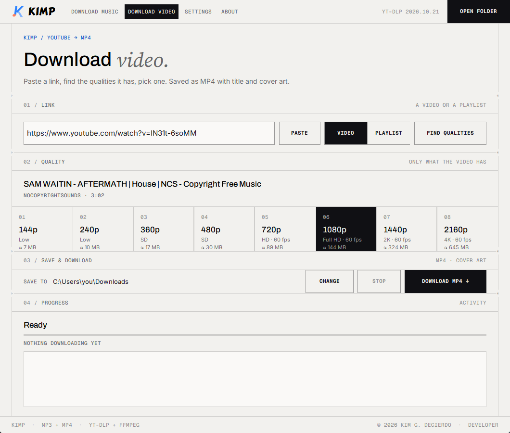

<h1 align="center">KIMP</h1>

<b>YouTube to MP3 and MP4 for Windows.</b> Paste a link, pick what to save, done. 
Developed by <b>Kim G. Decierdo</b> · <a href="https://kimp-qwtl.onrender.com">kimp-qwtl.onrender.com</a>

<a href="../../releases/latest"><b>⬇ Download KIMP for Windows</b></a>

This repository only hosts the **KIMP installer** for download. Get it from the [Releases](../../releases/latest) page.

## Android
**KIMP for Android 1.0** is on the [android-v1.0 release](../../releases/tag/android-v1.0): download
`KIMP-1.0-arm64-v8a.apk` (almost every phone; `armeabi-v7a` for very old ones), open it and allow
*install unknown apps*. Android 10 or newer. It's open source (GPL-3.0):
[MikDecierdo/KIMP-android](https://github.com/MikDecierdo/KIMP-android).

## What KIMP does
- **Music:** 320 kbps MP3 with title, artist and cover art. One song, a playlist, a whole channel, or every playlist on a channel. Stop any time and resume later.
- **Video:** *Find qualities* lists only the resolutions the video really has (144p up to 4K/8K, with 60 fps and estimated size). One video or a whole playlist, saved as MP4.
- Light, dark or follow-Windows theme. No accounts, no tracking; settings stay on your computer.

## Install
1. Download **`KIMP-Setup-1.1.exe`** from the [latest release](../../releases/latest).
2. Run it. If Windows says *"Windows protected your PC"*, click **More info → Run anyway**. The installer isn't code-signed yet.
3. Accept the terms of use and install. No admin rights needed.

Works on Windows 10 and 11 (64-bit). Needs an internet connection to download.

## Responsible use
Only download what you own, what's free to download, or what you have permission to save. Downloading copyrighted songs or videos without permission can break copyright law and YouTube's Terms of Service. KIMP doesn't unlock paid or protected content and isn't affiliated with, endorsed or sponsored by YouTube or Google. **You are responsible for how you use KIMP.**

[Terms of use](https://kimp-qwtl.onrender.com/terms.html) · [Third-party licenses](https://kimp-qwtl.onrender.com/licenses.html)

---

© 2026 Kim G. Decierdo. All rights reserved.
